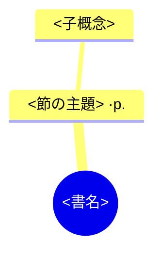
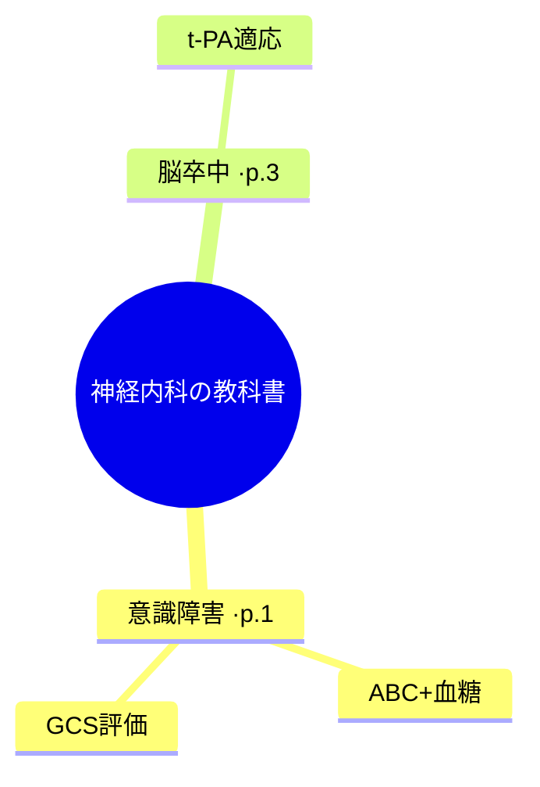

# Theta ダイジェスト相互運用仕様 `theta-digest-1`

FullOCR と **Theta.Book.Hatch**（旧 DSBooks）が、AI要約・マインドマップ・一問一答を
**同じ形式で読み書き**し、各項目から原典（PDFの該当ページ／本文の該当箇所）へ辿れる
ようにするための仕様。あわせて **Theta.Book.Hatch 側が Gemini API で自前生成する**
手順も定義する。

- スキーム識別子: **`theta-digest-1`**
- 前提仕様: ページ対応は [`docs/page-anchor-spec.md`](./page-anchor-spec.md)（`fullocr-1`）に依存
- 役割:
  - **FullOCR**: `fullocr digest` で `_digest.md`（＋EPUB）を生成（Gemini）。
  - **Theta.Book.Hatch**: ①FullOCR生成の `_digest.md` を**読む/描画**、②自前で Gemini を叩いて**生成**（同じ形式で保存）。

---

## 0. 設計原則（最重要）

> **要約文はLLM、引用ページは原データ。ページ番号をLLMに言わせない。**

LLMに「要約して、各項目にページ番号も付けて」とやるとページを捏造する。だから必ず：

1. 本文を **ページ範囲が既知の単位（節 or ページ窓）** に区切る。
2. その単位の本文だけをLLMに渡して要約/Q&A/マップ素材を得る。
3. **リンクのページは、こちら（アプリ）が把握している単位のページ**を使う。

両アプリともこの原則に従うこと。

---

## 1. ダイジェスト Markdown 形式（`_digest.md`）

### 1.1 先頭マーカー（検出用）

ファイル先頭に、独立行のHTMLコメント：

```
<!-- theta:digest scheme="theta-digest-1" generator="fullocr" pdf="本_text.pdf" -->
```

| 属性 | 意味 |
|---|---|
| `scheme` | 必須。`theta-digest-1`。これがあればダイジェストと判定。 |
| `generator` | 生成元（`fullocr` / `bookhatch`）。情報用。 |
| `pdf` | 原典PDFのファイル名（無ければ空）。ページリンクの飛び先。 |

抽出正規表現：
```regex
<!--\s*theta:digest\s+scheme="([^"]+)"(?:\s+generator="([^"]*)")?(?:\s+pdf="([^"]*)")?\s*-->
```

### 1.2 セクション構成

`##` 見出しで最大3ブロック。**無いブロックは省略可**。

```markdown
<!-- theta:digest scheme="theta-digest-1" generator="fullocr" pdf="本_text.pdf" -->
# <書名> — ダイジェスト
> （生成メモの引用。任意）

## 📖 構造化要約
### <節見出し>  <ソースリンク>
- 要点1
- 要点2

## 🧠 マインドマップ


## 🎴 一問一答
### <節見出し>  <ソースリンク>
- **Q.** <問>  
  **A.** <答>
```

ブロックの対応キー（パーサが区別する目印）:

| ブロック | 見出し行 |
|---|---|
| 構造化要約 | `## 📖 構造化要約` |
| マインドマップ | `## 🧠 マインドマップ`（直後に ```` ```mermaid ```` ブロック） |
| 一問一答 | `## 🎴 一問一答` |

> 絵文字に依存したくない実装のために、**パーサは見出し行に `構造化要約` / `マインドマップ` /
> `一問一答` の語を含むかで判定してよい**（絵文字は表示用）。

### 1.3 ソースリンク（両方向）

各 `###` 節見出しの末尾に、スペース区切りで付く。2種類：

```
[[本_text.pdf#page=9|📄p.1]] ・[[本#第1章 意識障害|§第1章 意識障害]]
```

| リンク | 形 | 用途 |
|---|---|---|
| 原文PDF | `[[<pdf>#page=<N>|📄p.<printed>]]` | PDFの物理ページ `N`（`fullocr-1` と同じ）。`printed` は表示用の印刷ページ |
| 生成MD見出し | `[[<md_basename>#<heading>|§<heading>]]` | 同じ保管庫内の本文MDの見出しへ |

Theta.Book.Hatch は **原文PDFリンクの `#page=N`** を `page-anchor-spec` のページジャンプと
同じ仕組みで解決すればよい（`N` は物理ページ）。印刷ページ表示 `p.<printed>` は
ラベルなので表示にだけ使う。

マインドマップのノードは Mermaid の制約でリンクを張れないため、`·p.<X>` の**注記**で
ページを示す（`X` は印刷ページ、無ければ物理ページ）。クリックで飛ばしたい実装は、
同じ節の要約/一問一答側のリンクを使うこと。

### 1.4 パース結果データモデル（推奨）

```jsonc
{
  "scheme": "theta-digest-1",
  "generator": "fullocr",
  "pdf": "本_text.pdf",
  "title": "神経内科の教科書",
  "sections": [
    {
      "heading": "第1章 意識障害",
      "pdf_page": 9,            // #page=N（物理, 飛び先）
      "printed_page": "1",      // 表示用（任意）
      "md_target": "神経内科の教科書", // 生成MD見出しリンクのファイル名（任意）
      "summary": ["…", "…"],
      "qa": [{"q": "…", "a": "…"}],
      "map": {"label": "意識障害", "children": ["ABC+血糖", "GCS評価"]}
    }
  ]
}
```

---

## 2. EPUB 形式（自己完結ジャンプ）

EPUBリーダーは外部PDFの `#page=N` を開けないことが多いので、**本文もEPUBに同梱**し、
内部アンカーで飛ばす。

- `text.xhtml`: 本文。各ページ先頭に `<span id="pdf-<N>"></span>`（ページアンカーのEPUB版）。
- `digest.xhtml`: 要約/マインドマップ(入れ子`<ul>`)/一問一答。各項目のソースリンクは
  `<a href="text.xhtml#pdf-<N>">→ p.<printed></a>`。
- spine は `nav, digest.xhtml, text.xhtml`。

Theta.Book.Hatch が EPUB を出力する場合も、この**内部アンカー規約 `id="pdf-<N>"`** に
合わせること（＝FullOCR生成EPUBと相互に開ける）。

---

## 3. Theta.Book.Hatch 側での Gemini 生成

### 3.1 入力の用意（グラウンディング）

Theta.Book.Hatch は手元に「本文MD（ページアンカー `fullocr-1` 入り）」または
「本文テキスト＋ページ対応」を持っている前提。生成手順：

1. **区切る**：見出し(`#`/`##`)で節に分割。見出しが乏しければ `fullocr:page` アンカーの
   連続 N ページ（既定8）を1単位にする。各単位の **page_start（物理ページ）** を控える。
2. 各単位の本文を取り出し、長ければ中略（例: 先頭2/3＋末尾1/3、上限〜6000字）。
3. 単位ごとに **1回** Gemini を呼び、JSON を得る（3.3）。
4. 返ってきた要約/Q&A/マップに、**こちらが控えた page_start** を付けてリンク化（§1.3）。
5. `_digest.md`（§1）または自前UIモデル（§1.4）に組み立てる。EPUBは §2。

### 3.2 Gemini REST 呼び出し

SDK（`@google/generative-ai` 等）でも素のRESTでもよい。REST の最小形：

```
POST https://generativelanguage.googleapis.com/v1beta/models/gemini-2.5-flash:generateContent
x-goog-api-key: <ユーザーが入力したAPIキー>
Content-Type: application/json
```

ボディ（**structured output** を使い、パースを安定させる）：

```json
{
  "systemInstruction": {
    "parts": [{ "text": "あなたは専門書の編集者です。与えられた節の本文だけを根拠に、正確で簡潔な日本語の要約素材を作ります。本文に無い情報は足さない。出力は指定スキーマのJSONのみ。" }]
  },
  "contents": [
    { "role": "user", "parts": [{ "text": "次の節『<見出し>』の本文を読み、要約素材を作ってください。\n\n=== 本文 ===\n<節の本文>\n=== ここまで ===" }] }
  ],
  "generationConfig": {
    "temperature": 0.2,
    "responseMimeType": "application/json",
    "responseSchema": {
      "type": "object",
      "properties": {
        "summary": { "type": "array", "items": { "type": "string" } },
        "qa": {
          "type": "array",
          "items": {
            "type": "object",
            "properties": { "q": { "type": "string" }, "a": { "type": "string" } },
            "required": ["q", "a"]
          }
        },
        "map": {
          "type": "object",
          "properties": {
            "label": { "type": "string" },
            "children": { "type": "array", "items": { "type": "string" } }
          }
        }
      }
    }
  }
}
```

生成する種類（summary / qa / map）を絞るときは、`responseSchema.properties` と
プロンプトから不要なキーを外してトークンを節約する。

### 3.3 応答の取り出し

`responseMimeType: application/json` のとき、本文は候補のテキストに**JSON文字列**で入る：

```
candidates[0].content.parts[0].text   // ← これを JSON.parse する
```

ガード：安全弁として、テキストから最初の `{...}` を正規表現で取り出してから `JSON.parse`
するとフェンスや前置きが混じっても落ちない。パース失敗時はその節を空扱いにして継続。

### 3.4 出力の互換性

Theta.Book.Hatch が生成したダイジェストを `_digest.md` に保存するなら、
先頭マーカーの `generator` を `bookhatch` にして §1 の形で書く。こうすれば
FullOCR 側・他のリーダーでもそのまま読める。

```
<!-- theta:digest scheme="theta-digest-1" generator="bookhatch" pdf="本_text.pdf" -->
```

### 3.5 APIキーの扱い

- キーは**ユーザーがアプリに入力**し、端末ローカルに保存（FullOCR も同方式）。
- **ログ・URL・送信ヘッダ以外に出さない**。コミットや共有物に含めない。
- 課金はユーザーのキーに対して発生。送信は「本文（節単位）」、受信は要約（入力の約1割）。
  事前に概算を出すなら「本文文字数 ÷ 1.8 ≒ 入力トークン」で見積もる。

---

## 4. マルチモーダル拡張（任意）

図の説明や、崩れた本文の補完に、ページ画像を併送できる（Gemini はマルチモーダル）。
`contents[].parts` に `inlineData`（`mimeType`, base64 `data`）を足す。ただし**ページ番号は
依然として画像から推測させない**（グラウンディング原則は不変）。

---

## 5. バージョニング

- 現行: `theta-digest-1`。
- 破壊的変更時は `theta-digest-2` に上げ、本書に差分を追記。`-1` の
  「先頭マーカー」「3ブロック構成」「`#page=N` リンク」「EPUBの `id="pdf-N"`」は後方互換に保つ。
- 関連仕様: ページ対応は [`page-anchor-spec.md`](./page-anchor-spec.md)（`fullocr-1`）。

---

## 付録: 最小サンプル（FullOCR 生成）

```markdown
<!-- theta:digest scheme="theta-digest-1" generator="fullocr" pdf="神経内科の教科書_text.pdf" -->
# 神経内科の教科書 — ダイジェスト
> FullOCR が生成。要約文はAI、引用ページは原データに基づきます。

## 📖 構造化要約
### 第1章 意識障害  [[神経内科の教科書_text.pdf#page=9|📄p.1]] ・[[神経内科の教科書#第1章 意識障害|§第1章 意識障害]]
- 意識障害の初期対応はABCと血糖チェックが最優先
- GCSは開眼・言語・運動の3軸で評価する

## 🧠 マインドマップ


## 🎴 一問一答
### 第1章 意識障害  [[神経内科の教科書_text.pdf#page=9|📄p.1]]
- **Q.** 意識障害で最初に評価するものは？  
  **A.** ABC と血糖
```
